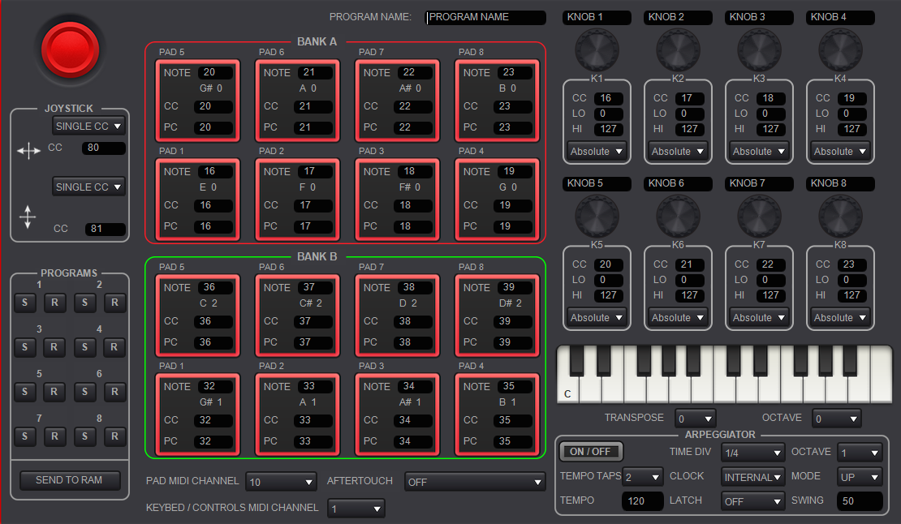
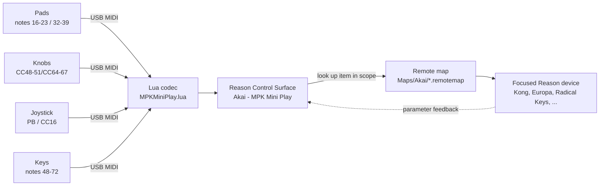
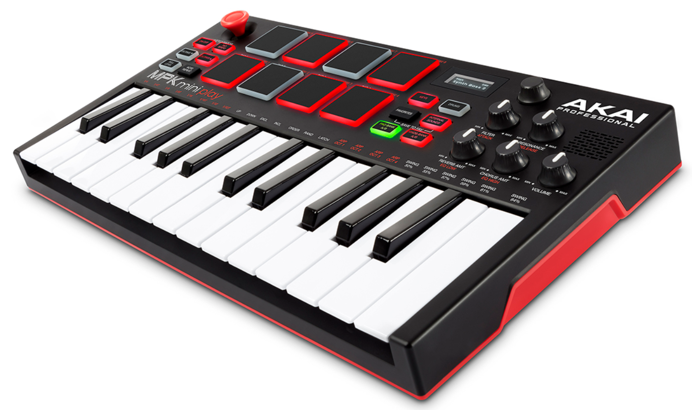

# MPK Mini Play Reason Remote

Remote scripts for **Reason** (Propellerheads) and the **Akai MPK Mini Play**.



---

## Purpose

Gives the MPK Mini Play a proper, two‑way Reason Remote integration: a Lua
codec plus a single `.remotemap` covering the most common Reason devices, mirroring
the structure of the
[Livid Instruments ReasonRemoteScripts](https://github.com/LividInstruments/ReasonRemoteScripts)
repository.

## How it works



The codec turns raw MIDI into named control events; the `.remotemap` binds
those control names to each device's **Scope** and remotable items. The codec
also keeps a small device-aware layer: it reads the focused scope from the
`_Scope` item so pads can behave differently per device (see
[Dr. Octo Rex](docs/dr-octo-rex.md#how-the-pads-work-on-dr-octo-rex)).

## Hardware profile



The MPK Mini Play exposes the following controls (see
[`mapping/mpk-mini-play-controls.json`](mapping/mpk-mini-play-controls.json)):

| Control        | Physical               | MIDI                        |
|----------------|------------------------|-----------------------------|
| Keyboard       | 25 velocity keys       | Notes 48               |
| Pads ×16       | 8 pads, 2 banks        | Bank A: notes 16–23 · Bank B: notes 32–39 → drum notes 36–51 (Dr. Octo Rex: loops 1–8 / Run) |
| Knobs ×8       | 4 knobs, 2 banks       | Bank A: CC48-51 · Bank B: CC64-67 |
| Joystick X     | Joystick horizontal    | Pitch Bend                  |
| Joystick Y     | Joystick vertical      | CC16 (mod wheel)             |
| Transport      | none                   | —                           |

Notes:

- MPK Mini Play has **no transport buttons** and **no aftertouch**.
- Keybed, knobs and joystick transmit on MIDI **channel 1**; the pads
  transmit on MIDI **channel 1** (Akai drum convention).
- The pads are **drum-note triggers** by default: the codec transposes Bank A
  to notes 36–43 and Bank B to notes 44–51 (through the Keyboard item), so the
  focused drum device (Kong, Redrum) plays them and every other device ignores
  them. Each press is also emitted as a mappable Pad item; **Dr. Octo Rex**
  uses those to select loops 1-8 / toggle Run, and the codec suppresses its
  drum notes. There is no pad-LED/note echo to the hardware.

```
```
        +---------------------------------------------------------------------------+
        |                           AKAI MPK Mini Play                              |
        |                                                                           |
        |   ^ Y (CC16)                                                              |
        |   |                Pads                      Knobs                        |
        |<--+--> X (PB)    +---+---+---+---+          o  o                          |
        |                  | 1 | 2 | 3 | 4 |          o  o                          |
        |                  +---+---+---+---+          A: CC48-51                    |
        |                  | 5 | 6 | 7 | 8 |          B: CC64-67                    |
        |                  +---+---+---+---+                                        |
        |                  A: 16-23                                                 |
        |                  B: 32-39                                                 |         
        |                                                                           |
        |   +---------------------------------------------------+                   |
        |   |               25 Velocity Keys                    |                   |
        |   |                   Notes 48-72                     |                   |
        |   +---------------------------------------------------+                   |
        |                                                                           |
        +---------------------------------------------------------------------------+
```​‌
```

## Installation

1. **Close Reason.**
2. **Deploy** the codec and maps into Reason's Remote folder:

   - **Windows** (PowerShell):

     ```powershell
     .\scripts\deploy.ps1
     ```

     which copies to
     `C:\ProgramData\Propellerhead Software\Remote\Codecs\Lua Codecs\Akai\`
     and `...\Remote\Maps\Akai\`.

   - **macOS / Linux** (shell):

     ```sh
     ./scripts/deploy.sh
     ```

     which copies to
     `/Library/Application Support/Propellerhead Software/Remote\...`
     (set `REMOTE_ROOT=` on non‑standard/WINE installs).

3. **Start Reason** and add the controller manually:
   Preferences → Control Surfaces → *Add* → **Akai** → **MPK Mini Play**.
   The MPK Mini Play is **not auto‑detected** (it does not reliably answer
   the SysEx identity request).
4. Select the MIDI input/output ports for the device.

> Manual install (if you prefer): drag these files into place:
>
> - `Codecs/Lua Codecs/Akai/MPKMiniPlay.lua`
> - `Codecs/Lua Codecs/Akai/MPKMiniPlay.luacodec`
> - `Codecs/Lua Codecs/Akai/MPKMiniPlay.png`
>   → `…/Remote/Codecs/Lua Codecs/Akai/`
> - `Maps/Akai/*.remotemap`
>   → `…/Remote/Maps/Akai/`
>
> All three codec files are required: Reason registers a control surface
> from the **`.luacodec`** descriptor (which names the `.lua` and `.png`);
> the `.lua` alone will not appear in the Control Surfaces list.

## Device support

All device scopes live in the single `Maps/Akai/MPKMiniPlay.remotemap`. Each
row below lists the Reason **Scope** that file maps for that device.

| Device              | Scope                                             | Pads → | Knobs A/B | Joystick | Keyboard |
|---------------------|---------------------------------------------------|--------|-----------|----------|----------|
| Kong Drum Designer  | Propellerheads / Kong Drum Designer | drums 36–51 | Master + Bus/FX | pitch/mod | ✓ |
| Redrum              | Propellerheads / Redrum Drum Computer | drums 36–51 | Levels/Pans | n/a (override) | ✓ |
| Dr. Octo Rex        | Propellerheads / Dr.REX Loop Player | loops 1–8 / Run | Level/Transpose + LFO | pitch/mod | ✓ |
| SubTractor          | Propellerheads / SubTractor Analog Synthesizer | drums 36–51 | Filter/Env | pitch/mod | ✓ |
| Thor                | Propellerheads / THOR Polysonic Synthesizer | drums 36–51 | Filters/Env | pitch/mod | ✓ |
| NN-XT               | Propellerheads / NN-XT Advanced Sampler | drums 36–51 | Filter/Amp | pitch/mod | ✓ |
| NN-19               | Propellerheads / NN19 Digital Sampler | drums 36–51 | Filter+LFO / Amp env | pitch/mod | ✓ |
| Europa              | Propellerhead Software / se.propellerheads.Europa | drums 36–51 | Filter/Env | pitch/mod | ✓ |
| Grain               | Propellerhead Software / se.propellerheads.Grain | drums 36–51 | Sample/FX + Env | pitch/mod | ✓ |
| Rytmik              | Propellerhead Software / se.propellerheads.DMFC | drums 36–51 | Drum levels | n/a (override) | ✓ |
| Malstrom            | Propellerheads / Malstrom Graintable Synthesizer | drums 36–51 | Filters/Mods | pitch/mod | ✓ |
| Monotone            | Propellerhead Software / se.propellerheads.Monotone | drums 36–51 | Voice/Amp env | pitch/mod | ✓ |
| Radical Piano       | Propellerhead Software / se.propellerheads.radicalpiano | drums 36–51 | Character/Mics + Env | pitch only | ✓ |
| Radical Keys        | Propellerhead Software / se.propellerheads.radicalkeys | drums 36–51 | Tone/Blend + Env | pitch only | ✓ |
| ID8                 | Propellerheads / ID8 Instrument Device | drums 36–51 | Volume + P1/P2 | n/a (override) | ✓ |
| Klang               | Propellerhead Software / se.propellerheads.Klang | drums 36–51 | Filter/FX | n/a (override) | ✓ |
| Pangea              | Propellerhead Software / se.propellerheads.Pangea | drums 36–51 | Filter/FX | n/a (override) | ✓ |
| Humana              | Propellerhead Software / se.propellerheads.Humana | drums 36–51 | Filter/FX | n/a (override) | ✓ |
| Combinator 2        | Propellerheads / Combinator | drums 36–51 | Rotaries/Globals | pitch/mod | ✓ |
| Mixer 14:2 + Master | Propellerheads / Mixer 14:2 + Reason Master Section | drums 36–51 | Levels/Pans | Master level | ✓ |

The **Pads →** column is device-agnostic by default: every device receives the
same drum notes 36–51, so Kong and Redrum play the pads directly while other
devices ignore them. **Dr. Octo Rex** is the one exception — its pads select
loops 1–8 / toggle Run instead of sending notes (see [Dr. Octo Rex
pads](docs/dr-octo-rex.md#how-the-pads-work-on-dr-octo-rex)).

Notes:

- **Dr. Octo Rex** keeps the legacy `Dr.REX Loop Player` device ID in Reason
  (for backwards compatibility), so its map Scope uses that ID — the preset
  shows as "Dr. Octo Rex".
- **NN-19** uses the legacy device ID `Propellerheads` /
  `NN19 Digital Sampler` — the ID has no hyphen even though Reason displays
  the device as "NN-19". It has a single LFO (`LFO Rate`/`Amount`/`Wave`/
  `Dest`), not LFO1/LFO2.
- **Rytmik** is a Reason Compact-derived device: its scope is
  `se.propellerheads.DMFC` and its remotable names use underscores
  (`Drum_1_Volume`, `Drum_1_Mute`, `Master_Volume`, ...).
- **Klang**, **Pangea** and **Humana** are ID8-family devices that expose the
  same parameter set with underscore names (`Filter_Cutoff`, `Amp_Attack`, ...)
  and neither pitch bend nor mod wheel, so their joystick lines ship
  commented and are re-pointed via Remote Overrides.
- **ID8** exposes only `Volume`, `Parameter 1` and `Parameter 2` as knobs; the
  remaining knob slots ship commented for Remote Overrides.
- **Pads** are device-agnostic by default: they send Reason drum notes 36–51
  through the Keyboard item, so Kong/Redrum play them and other devices ignore
  them. **Dr. Octo Rex** is the exception: its pads are mapped per device
  (Bank A pads 1-8 → loops 1-8, Bank B pad 1 → Run) and the codec suppresses
  their drum notes via `gSuppressPadNotes` so they do not also play. See the
  [Dr. Octo Rex page](docs/dr-octo-rex.md#how-the-pads-work-on-dr-octo-rex).
- **Radical Keys** uses the CamelCase device ID
  `se.propellerheads.RadicalKeys` (note: *Radical Piano* is lowercase,
  `se.propellerheads.radicalpiano`). Its remote item names follow the Reason
  template (`Character`, `Instrument Blend`, `mic1`, `mic2`, `Vel Resp Curve`,
  `Comp Amount`, `Ambience Level`, ...). It responds to **Pitch Bend** and
  Sustain Pedal but exposes no Mod Wheel, so its joystick Y line ships
  commented and is re-pointed via Remote Overrides. *Radical Piano* is the
  same: pitch bend only, joystick Y ships commented.

See [`mapping/device-capabilities.json`](mapping/device-capabilities.json)
for the full remotable parameter list and
[`mapping/matrix.csv`](mapping/matrix.csv) for the control → MIDI → device
mapping matrix.

Per‑device documentation lives in [`docs/`](docs/) — one page per device with
the control‑map picture, the MIDI binding of every control, the Reason
**Scope** and device‑specific notes. Start at [`docs/README.md`](docs/README.md).

## Mapping philosophy

- **Pads** → device-agnostic drum notes by default: Bank A sends notes 36–43
  and Bank B sends 44–51 (delivered through the Keyboard item), so the focused
  drum device (Kong, Redrum) plays them directly; other devices ignore them.
  The codec can also emit a mappable Pad item per press, and a device can opt
  into per-device pad mapping with note suppression (Dr. Octo Rex: Bank A →
  loops 1-8, Bank B pad 1 → Run). See
  [Dr. Octo Rex pads](docs/dr-octo-rex.md#how-the-pads-work-on-dr-octo-rex).
- **Knob bank A** (CC48-51) → the "four most‑edited" parameters of the device.
- **Knob bank B** (CC64-67) → the second layer: envelopes, sends, pans.
- **Joystick X** → pitch bend (global). **Joystick Y** → mod wheel (CC16).
- **Keyboard** → always the instrument keyboard with velocity.
- Devices map cleanly inside their natural **Scope** names so switching the
  focused device just works.

```
        Knob bank A (CC48-51)                Knob bank B (CC64-67)
   +------+------+------+------+      +------+------+------+------+
   |  1   |  2   |  3   |  4   |      |  1   |  2   |  3   |  4   |
   | 1st  | 2nd  | 3rd  | 4th  |      | env  | send | pan  | mast |
   +------+------+------+------+      +------+------+------+------+
     "four most-edited"                  second layer:
      device parameters                  envelopes, sends, pans
```

## Test plans

Work through the per‑device test suites under [`tests/`](tests/):

- [Kong](tests/kong-test.md)
- [Redrum](tests/redrum-test.md)
- [Dr. Octo Rex](tests/dr-octo-rex-test.md)
- [SubTractor](tests/subtractor-test.md)
- [Thor](tests/thor-test.md)
- [NN-XT](tests/nnxt-test.md)
- [NN-19](tests/nn19-test.md)
- [Europa](tests/europa-test.md)
- [Grain](tests/grain-test.md)
- [Rytmik](tests/rytmik-test.md)
- [Malstrom](tests/malstrom-test.md)
- [Monotone](tests/monotone-test.md)
- [Radical Piano](tests/radical-piano-test.md)
- [Radical Keys](tests/radical-keys-test.md)
- [ID8](tests/id8-test.md)
- [Klang](tests/klang-test.md)
- [Pangea](tests/pangea-test.md)
- [Humana](tests/humana-test.md)
- [Combinator 2](tests/combinator2-test.md)

## ASCII hardware diagrams

Four complementary ASCII renderings of the MPK Mini Play, each serving a
different purpose. All are plain monospaced text (no image files).

### 1. Blueprint style (technical, precise, monospaced)

```
+-----------------------------------------------------------------------+
|                           AKAI MPK MINI PLAY                          |
|-----------------------------------------------------------------------|
| JOYSTICK (Pitch/Mod)                                                  |
|                                                                       |
|        ^  Y (Mod CC16)                                                |
|        |                                                              |
|    <-- + --> X (Pitch Bend)                                           |
|                                                                       |
|-----------------------------------------------------------------------|
| KNOBS (Bank A CC48-51 / Bank B CC64-67)                               |
|                                                                       |
|    +---------+---------+---------+---------+                          |
|    | Knob 1  | Knob 2  | Knob 3  | Knob 4  |   [Knob Bank A/B]        |
|    +---------+---------+---------+---------+                          |
|                                                                       |
|-----------------------------------------------------------------------|
| KNOBS (Bank A CC48-51 / Bank B CC64-67)                               |
|                                                                       |
|    +---------+---------+---------+---------+                          |
|    | Knob 1  | Knob 2  | Knob 3  | Knob 4  |   [Knob Bank A/B]        |
|    +---------+---------+---------+---------+                          |
|                                                                       |
|-----------------------------------------------------------------------|
| SCREEN + ENCODER                                                      |
|                                                                       |
|   [LCD Display]   [Data Dial]                                         |
|                                                                       |
+-----------------------------------------------------------------------+
```

### 2. Schematic block diagram (clean, minimal, logical)

```
+-------------------+     +---------------------------+
|     Joystick      |     |        Knobs 1–4          |
|  X = Pitch Bend   |     |  Bank A/B CC48-51/CC64-67 |
|  Y = Mod (CC16)   |     +---------------------------+
+-------------------+     | Knob Bank Switch          |
                          +---------------------------+

+-------------------+     +---------------------------+
|   Arp / Tempo     |     |   Full Level / Note Rep   |
|   Octave +/-      |     |   Drums / Keys            |
+-------------------+     +---------------------------+

+-------------------+     +---------------------------+
|      Pads         |     |       Keyboard            |
|  P1–P8 (A/B)      |     |   25 Velocity Keys        |
|  Notes 16–23      |     |       Notes 48            |
|        32–39      |     |                           |
+-------------------+     +---------------------------+

+-------------------+
| Screen + Encoder  |
+-------------------+
```

### 3. README-ready layout

```
AKAI MPK MINI PLAY — Hardware Layout
====================================

Joystick
--------
  • X-axis: Pitch Bend
  • Y-axis: Mod Wheel (CC16)

Knobs (8 virtual via A/B bank)
------------------------------
  • Bank A: CC48-51
  • Bank B: CC64-67
  • Knob Bank A/B switch

Pads (8 pads × 2 banks)
-----------------------
  • Bank A notes: 16–23
  • Bank B notes: 32–39
  • Pad Bank A/B switch

Buttons
-------
  • Arp On/Off
  • Tap Tempo
  • Note Repeat
  • Full Level
  • Octave Up/Down
  • Drums / Keys
  • Favorites
  • Internal Sounds

Keyboard
--------
  • 25 velocity-sensitive keys
  • MIDI notes 48\u201372

Screen + Encoder
----------------
  • LCD display
  • Data dial
```

### 4. Controller mapping overlay

```
+-----------------------------------------------------------------------+
| JOYSTICK: X = Pitch Bend, Y = CC16 (Mod Wheel)                        |
|                                                                       |
| KNOBS:                                                                |
|   Bank A: K1=CC48 K2=CC49 K3=CC50 K4=CC51                             |
|   Bank B: K1=CC64 K2=CC65 K3=CC66 K4=CC67                             |
|                                                                       |
| PADS:                                                                 |
|   Bank A: P1=16 P2=17 P3=18 P4=19 P5=20 P6=21 P7=22 P8=23             |
|   Bank B: P1=32 P2=33 P3=34 P4=35 P5=36 P6=37 P7=38 P8=39             |
|                                                                       |
| KEYBOARD: Notes 48\u201372                                            |
+-----------------------------------------------------------------------+
```
# Lua
The official Lua website is:

🔗 https://www.lua.org/ - The Programming Language Lua

Useful pages:

Getting Started: https://www.lua.org/start.html
Documentation / Reference Manual: https://www.lua.org/docs.html
Download Lua: https://www.lua.org/download.html

## License / credits

- Reason, Kong, Redrum, SubTractor, Thor, NN-XT, NN-19, Combinator, Dr. Octo Rex,
  Europa, Grain, Rytmik, Malstrom, Monotone, Radical Piano, Radical Keys,
  ID8, Klang, Pangea, Humana, and the Remote system are trademarks of Reason
  Studios (formerly Propellerhead).
- Inspired by the folder layout of
  [Livid Instruments ReasonRemoteScripts](https://github.com/LividInstruments/ReasonRemoteScripts).
- Built for the AKAI MPK Mini Play MIDI controller.

Not an official Reason Studios or inMusic/AKAI product.
