# Device documentation

One page per mapped device. Each page shows the control map, the MIDI
binding for every control, the Reason **Scope** and the device-specific notes.

Part of the [Akai MPK Mini Play Reason Remote](../README.md) project.

| Preview | Device | Scope | Map | Test plan |
|---------|--------|-------|-----|-----------|
| <a href="./combinator2.md">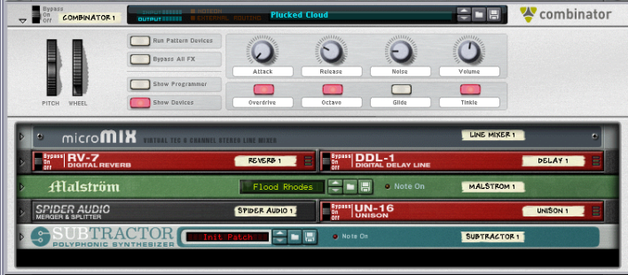</a> | [Combinator 2](./combinator2.md) | `Propellerheads / Combinator` | [`Combinator2.remotemap`](../Maps/Akai/MPKMiniPlay.remotemap) | [test](../tests/combinator2-test.md) |
| <a href="./dr-octo-rex.md">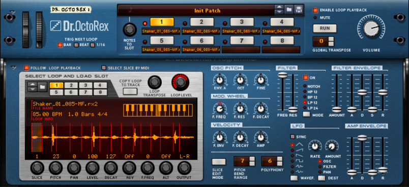</a> | [Dr. Octo Rex Loop Player](./dr-octo-rex.md) | `Propellerheads / Dr.REX Loop Player` | [`DrOctoRex.remotemap`](../Maps/Akai/MPKMiniPlay.remotemap) | [test](../tests/dr-octo-rex-test.md) |
| — | [Drum Sequencer](./drum-sequencer.md) | `Propellerhead Software / se.propellerheads.DrumSeq` | [`DrumSeq.remotemap`](../Maps/Akai/MPKMiniPlay.remotemap) | [test](../tests/drum-sequencer-test.md) |
| <a href="./europa.md">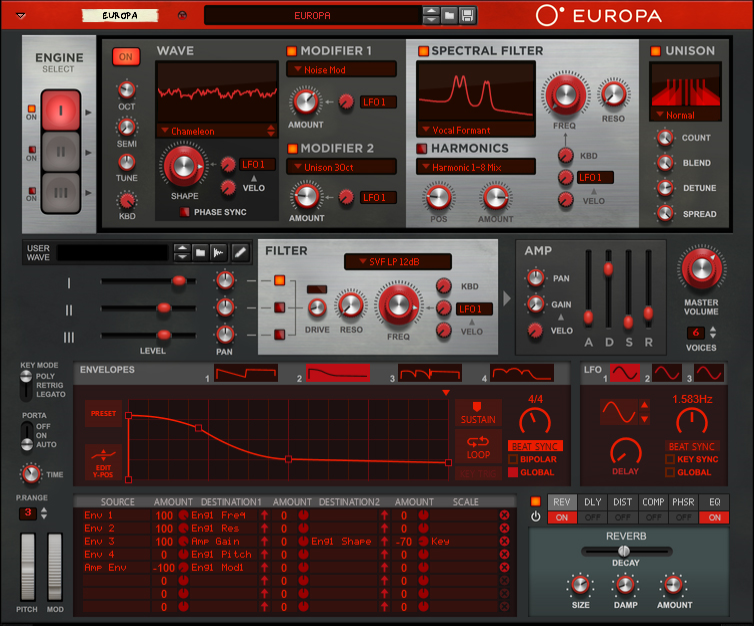</a> | [Europa Shapeshifting Synthesizer](./europa.md) | `Propellerhead Software / se.propellerheads.Europa` | [`Europa.remotemap`](../Maps/Akai/MPKMiniPlay.remotemap) | [test](../tests/europa-test.md) |
| <a href="./grain.md">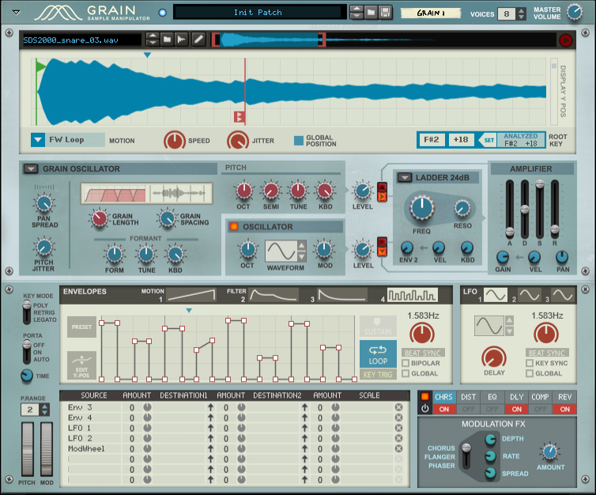</a> | [Grain Sample Manipulator](./grain.md) | `Propellerhead Software / se.propellerheads.Grain` | [`Grain.remotemap`](../Maps/Akai/MPKMiniPlay.remotemap) | [test](../tests/grain-test.md) |
| <a href="./humana.md">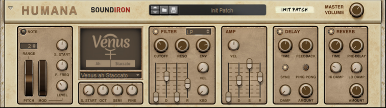</a> | [Humana Vocal Ensemble](./humana.md) | `Propellerhead Software / se.propellerheads.Humana` | [`Humana.remotemap`](../Maps/Akai/MPKMiniPlay.remotemap) | [test](../tests/humana-test.md) |
| <a href="./id8.md">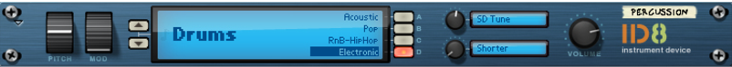</a> | [ID8 Instrument Device](./id8.md) | `Propellerheads / ID8 Instrument Device` | [`ID8.remotemap`](../Maps/Akai/MPKMiniPlay.remotemap) | [test](../tests/id8-test.md) |
| <a href="./klang.md">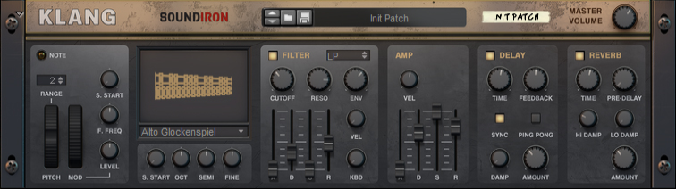</a> | [Klang Tuned Percussion](./klang.md) | `Propellerhead Software / se.propellerheads.Klang` | [`Klang.remotemap`](../Maps/Akai/MPKMiniPlay.remotemap) | [test](../tests/klang-test.md) |
| <a href="./kong.md">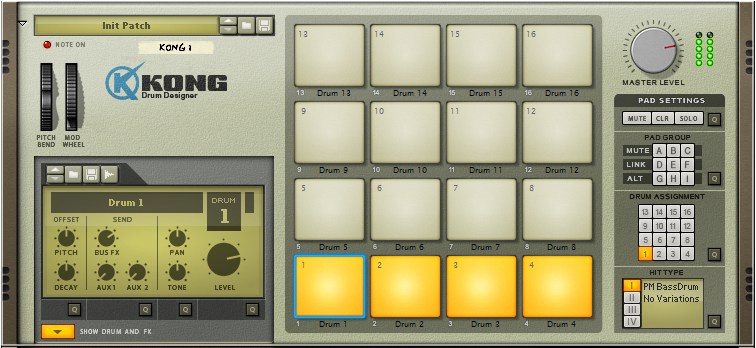</a> | [Kong Drum Designer](./kong.md) | `Propellerheads / Kong Drum Designer` | [`Kong.remotemap`](../Maps/Akai/MPKMiniPlay.remotemap) | [test](../tests/kong-test.md) |
| <a href="./malstrom.md">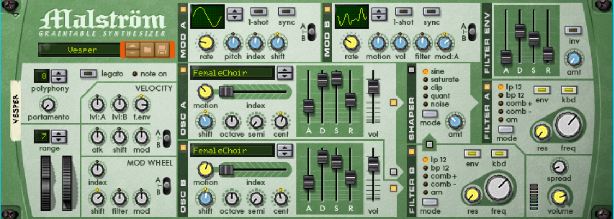</a> | [Malstrom Graintable Synthesizer](./malstrom.md) | `Propellerheads / Malstrom Graintable Synthesizer` | [`Malstrom.remotemap`](../Maps/Akai/MPKMiniPlay.remotemap) | [test](../tests/malstrom-test.md) |
| <a href="./mixer.md">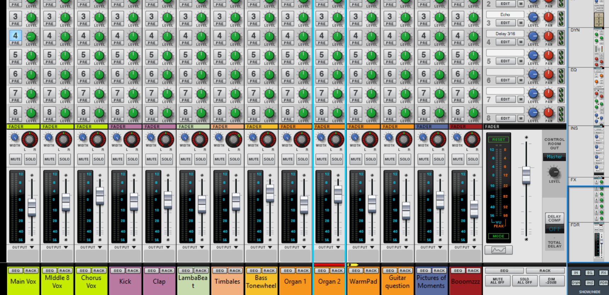</a> | [Mixer 14:2 + Reason Master Section](./mixer.md) | `Propellerheads / Mixer 14:2 + Propellerheads / Reason Master Section` | [`Mixer.remotemap`](../Maps/Akai/MPKMiniPlay.remotemap) | - |
| <a href="./monotone.md">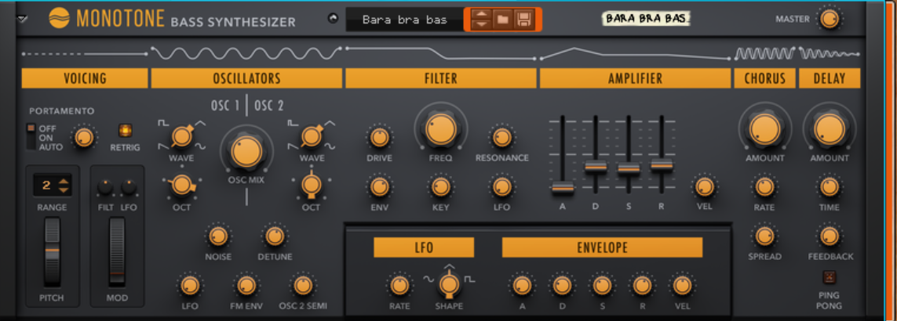</a> | [Monotone Bass Synthesizer](./monotone.md) | `Propellerhead Software / se.propellerheads.Monotone` | [`Monotone.remotemap`](../Maps/Akai/MPKMiniPlay.remotemap) | [test](../tests/monotone-test.md) |
| <a href="./nn19.md">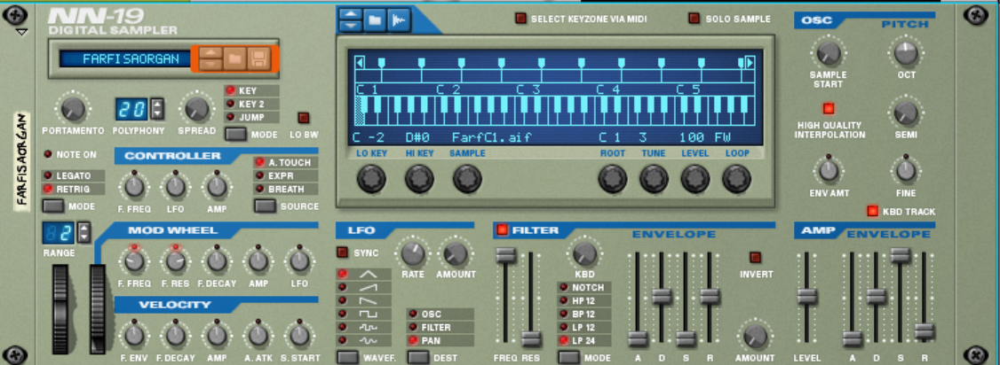</a> | [NN-19 Digital Sampler](./nn19.md) | `Propellerheads / NN19 Digital Sampler` | [`NN19.remotemap`](../Maps/Akai/MPKMiniPlay.remotemap) | [test](../tests/nn19-test.md) |
| <a href="./nnxt.md">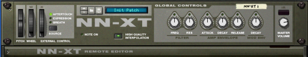</a> | [NN-XT Advanced Sampler](./nnxt.md) | `Propellerheads / NN-XT Advanced Sampler` | [`NNXT.remotemap`](../Maps/Akai/MPKMiniPlay.remotemap) | [test](../tests/nnxt-test.md) |
|  | [Pangea World Instruments](./pangea.md) | `Propellerhead Software / se.propellerheads.Pangea` | [`Pangea.remotemap`](../Maps/Akai/MPKMiniPlay.remotemap) | [test](../tests/pangea-test.md) |
| <a href="./radical-keys.md">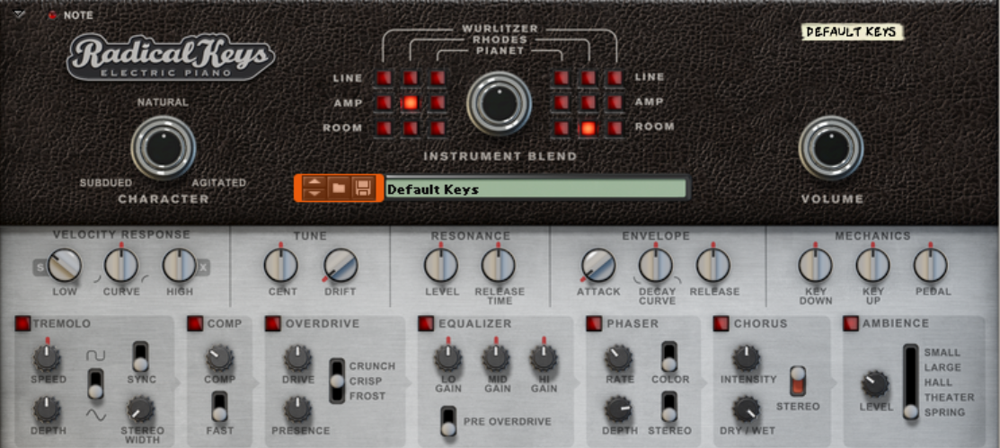</a> | [Radical Keys](./radical-keys.md) | `Propellerhead Software / se.propellerheads.RadicalKeys` | [`RadicalKeys.remotemap`](../Maps/Akai/MPKMiniPlay.remotemap) | [test](../tests/radical-keys-test.md) |
| <a href="./radical-piano.md">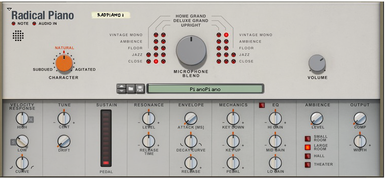</a> | [Radical Piano](./radical-piano.md) | `Propellerhead Software / se.propellerheads.radicalpiano` | [`RadicalPiano.remotemap`](../Maps/Akai/MPKMiniPlay.remotemap) | [test](../tests/radical-piano-test.md) |
| <a href="./redrum.md">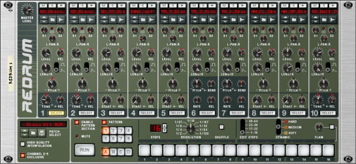</a> | [Redrum Drum Computer](./redrum.md) | `Propellerheads / Redrum Drum Computer` | [`Redrum.remotemap`](../Maps/Akai/MPKMiniPlay.remotemap) | [test](../tests/redrum-test.md) |
| <a href="./rytmik.md">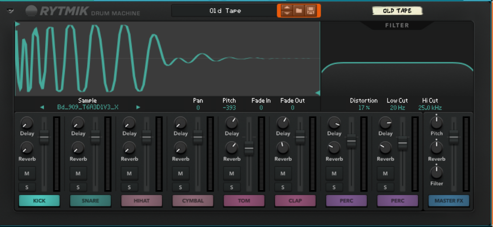</a> | [Rytmik Drum Machine](./rytmik.md) | `Propellerhead Software / se.propellerheads.DMFC` | [`Rytmik.remotemap`](../Maps/Akai/MPKMiniPlay.remotemap) | [test](../tests/rytmik-test.md) |
| <a href="./subtractor.md">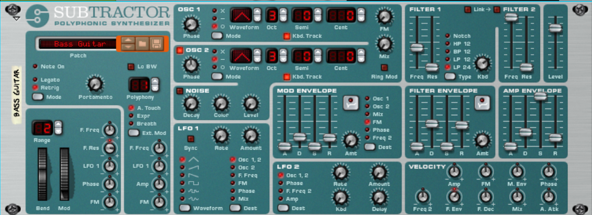</a> | [SubTractor Analog Synthesizer](./subtractor.md) | `Propellerheads / SubTractor Analog Synthesizer` | [`Subtractor.remotemap`](../Maps/Akai/MPKMiniPlay.remotemap) | [test](../tests/subtractor-test.md) |
| <a href="./thor.md">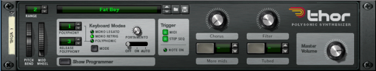</a> | [Thor Polysonic Synthesizer](./thor.md) | `Propellerheads / Thor Polysonic Synthesizer` | [`Thor.remotemap`](../Maps/Akai/MPKMiniPlay.remotemap) | [test](../tests/thor-test.md) |

