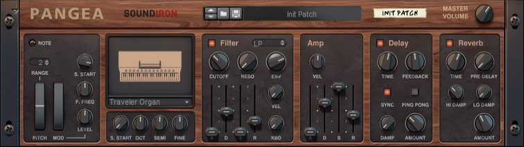

# Pangea World Instruments

Per-device reference for the **Akai MPK Mini Play** Reason Remote setup.

- **Device under test:** Akai MPK Mini Play -> Pangea World Instruments
- **Scope:** `Propellerhead Software / se.propellerheads.Pangea`
- **Map file:** `Maps/Akai/MPKMiniPlay.remotemap`
- **Test plan:** [tests/pangea-test.md](../tests/pangea-test.md)



## Control map

```
   Knob A (CC48-51)          Knob B (CC64-67)
   1 Filter_Cutoff   2 Filter_Reso    1 Synced_Delay_Time   2 Delay_Feedback
   3 Filter_Env      4 Amp_Velocity   3 Reverb_Time         4 Reverb_PreDelay

   Pads     : drum notes 36-51 (Bank A 36-43, Bank B 44-51)
   Joystick : unmapped (Pangea has no Pitch Bend / Mod Wheel)
   Keyboard : notes 48-72 (velocity)
```

## Scope

| Manufacturer | Device ID |
|--------------|-----------|
| Propellerhead Software | `se.propellerheads.Pangea` |

## Mapping

| Control | MIDI | Remotable item |
|---------|------|----------------|
| Keyboard | Notes 48-72 | Keyboard |
| Knob 1 A | CC48 | Filter_Cutoff |
| Knob 2 A | CC49 | Filter_Reso |
| Knob 3 A | CC50 | Filter_Env |
| Knob 4 A | CC51 | Amp_Velocity |
| Knob 1 B | CC64 | Synced_Delay_Time |
| Knob 2 B | CC65 | Delay_Feedback |
| Knob 3 B | CC66 | Reverb_Time |
| Knob 4 B | CC67 | Reverb_PreDelay |

Shipped commented (reserved / override templates):

| Control | MIDI | Remotable item |
|---------|------|----------------|
| Joystick X | Pitch Bend | Pitch Bend |
| Joystick Y | CC16 | Filter_Env |

## Details

- ID8-family device: scope `se.propellerheads.Pangea`, underscore parameter names.
- No pitch bend or mod wheel; joystick lines ship commented and are re-pointed via Remote Overrides.

## See also

- [Device documentation index](README.md)
- [Repository README](../README.md)
- [Map source](../Maps/Akai/MPKMiniPlay.remotemap)
- [Test plan](../tests/pangea-test.md)
- [Control -> MIDI matrix](../mapping/matrix.csv)
- [Capabilities](../mapping/device-capabilities.json)

